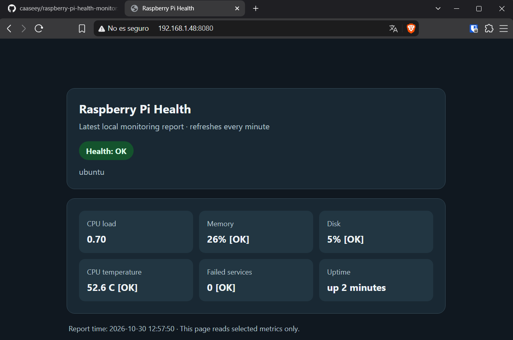

# Raspberry Pi System Health Monitor

A lightweight Linux system monitoring solution developed with Bash and Python for Raspberry Pi.

## Overview

This project monitors the health of a Raspberry Pi running Ubuntu Server.

It collects system metrics, detects potential issues, generates Markdown reports and automates monitoring through systemd timers.

It also includes a lightweight web dashboard to visualize the latest monitoring report from any device connected to the local network.

## Features

### System Monitoring
- CPU load monitoring
- RAM usage monitoring
- Disk usage monitoring
- CPU temperature monitoring
- System uptime monitoring
- Failed systemd services detection

### Alerts and Reports
- Configurable warning and critical thresholds
- OK, WARNING and CRITICAL health states
- Automatic Markdown report generation
- Automatic cleanup of reports older than 30 days

### Automation and Testing
- Scheduled execution every 30 minutes using systemd
- Simulation mode for OK, WARNING and CRITICAL scenarios
- Automated threshold tests

### Web Dashboard
- Read-only web interface developed with Python
- Displays the latest system health report
- Automatic refresh every 60 seconds
- Accessible from devices on the local network

## Dashboard

The web dashboard provides a simple overview of the Raspberry Pi's current health.



## Technologies

- Ubuntu Server 24.04.5 LTS
- GNU Bash
- Python 3
- systemd
- Git

## Hardware

Developed and tested on:

- Raspberry Pi 3 Model B Rev 1.2
- Ubuntu Server 24.04.5 LTS
- ARM64 architecture

## Project Structure

```text
raspberry-pi-health-monitor/
├── dashboard/
│   ├── health-dashboard.py
│   └── systemd-health-dashboard.service
├── docs/
│   ├── architecture.md
│   ├── installation.md
│   ├── testing.md
│   └── dashboard.md
├── reports/
│   └── .gitkeep
├── scripts/
│   └── health-check.sh
├── tests/
│   └── test-thresholds.sh
├── systemd-health-check.service
├── systemd-health-check.timer
├── .gitignore
└── README.md
```

## Installation

Clone the repository:

```bash
git clone https://github.com/caaseey/raspberry-pi-health-monitor.git
cd raspberry-pi-health-monitor
```

Make the monitoring script executable:

```bash
chmod +x scripts/health-check.sh
```

Run the monitor:

```bash
./scripts/health-check.sh
```

For complete installation instructions, see [Installation Guide](docs/installation.md).

## Testing

Run the automated threshold tests:

```bash
bash tests/test-thresholds.sh
```

Test the monitoring simulation:

```bash
./scripts/health-check.sh --test
```

The simulation covers three scenarios:

- OK
- WARNING
- CRITICAL

See [Testing Documentation](docs/testing.md) for more details.

## Web Dashboard

The dashboard runs as a systemd service on port 8080.

Access it from a device connected to the same local network:

```text
http://YOUR_PI_IP:8080/
```

See [Dashboard Documentation](docs/dashboard.md) for installation and configuration.

## Documentation

- [Architecture](docs/architecture.md)
- [Installation](docs/installation.md)
- [Testing](docs/testing.md)
- [Web Dashboard](docs/dashboard.md)

## License

MIT License
